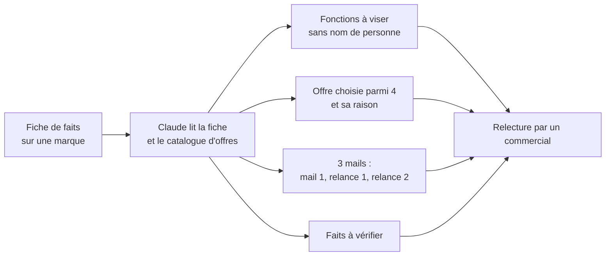

# Assistant de préparation de prospection média

Projet de démonstration : un assistant (n8n + Claude) qui, à partir d'une fiche de faits sur une marque, prépare le travail d'un commercial média : fonctions à viser, offre à proposer, trois mails de séquence et liste de faits à vérifier. **Un humain relit tout avant envoi ; l'assistant n'envoie rien.**

> **Tout est fictif.** La régie (Hexamédia), ses quatre sites, ses offres et les 40 marques sont inventés. Aucune donnée réelle (prospect, contact, tarif, chiffre d'une entreprise) n'a été utilisée. Le projet est **conçu à partir de ma pratique de la prospection** (séquences email en 3 temps, ciblage par secteur) et **testé sur des données synthétiques ; il n'a jamais été utilisé en production**, ni chez un employeur.

## Ce que fait l'assistant

- Il n'utilise que les faits de la fiche et signale un chiffre contradictoire, un fait de plus de 2 ans ou une information manquante.
- Il propose des **fonctions** (par exemple « directeur marketing »), jamais des personnes nommées : trouver des contacts est hors périmètre.
- Pas de prix, pas de résultat promis, pas d'alerte juridique (hors périmètre).

## Résultats

Tous les chiffres sont **mesurés** sur des fiches synthétiques. Une seule exécution par version (le modèle n'est pas déterministe). Détail et limites : [`evaluation/resultats_prospection.md`](evaluation/resultats_prospection.md).

| Mesure | Résultat |
|---|---|
| Pièges signalés (fiches avec chiffre contradictoire, fait ancien ou info manquante) | 12/12 au test, 10/10 en validation, pour Haiku 5.5 et Sonnet 5.5 |
| Baseline sans IA (gabarit unique) | 0 piège signalé, « responsable marketing » pour toutes les marques |
| Offre « contenu de marque » (diversité) | 88 % avec le prompt v1, 53 à 62 % avec v2 |
| Notation IA sur 12 fiches de validation (moyenne sur 4) | Haiku : exactitude 3,92, signalement 3,67, ciblage 4,0, pertinence 3,33, mails 3,75. Sonnet : 3,92 / 3,67 / 3,92 / 3,67 / 3,5 |
| Accord juge IA / contrôle humain à l'aveugle (10 sorties) | 35 notes sur 50 identiques (70 %), 49 sur 50 à 1 point près ; l'IA est plus sévère |
| Coût mesuré | Haiku 5.5 environ 0,002 $ par fiche ; Sonnet 5.5 environ 0,030 $ par fiche (17 fois plus) |

**Recommandation : Haiku 5.5**, qui n'a pas montré de défaut que Sonnet évite sur cet échantillon.

## Ce que ces résultats ne prouvent pas

- **Le signalement est gonflé** : l'assistant met des alertes sur presque toutes les fiches, y compris sans piège (liste vide 1 fois sur 18 pour Haiku). Détecter tous les pièges est donc facile ; savoir dire « rien à signaler » n'est pas acquis. Défaut documenté, non corrigé.
- La baseline est faible : la comparaison juste serait avec des mails écrits à la main, non faite.
- Les 28 fiches de test ont servi à corriger le prompt ; seule la validation (12 fiches) est non biaisée.
- Le juge IA est de la même famille que les modèles évalués ; le contrôle humain est un seul évaluateur, l'auteur, sur 10 sorties.
- Aucune mesure d'utilité réelle (taux de réponse, temps gagné). La comparaison Haiku / Sonnet repose sur très peu de cas.

## Contenu du dépôt

| Dossier | Contenu |
|---|---|
| [`docs/`](docs/) | [Cadrage](docs/cadrage.md) (périmètre, critères fixés avant les tests) et [étude de cas](docs/etude_de_cas.md) |
| [`data/`](data/) | 40 marques synthétiques (28 test, 12 validation), régie fictive, script de génération |
| [`baseline/`](baseline/) | Gabarit sans IA et ses sorties |
| [`prompts/`](prompts/) | Prompt v1 et prompt v2 (gelé avant la validation) |
| [`workflow/`](workflow/) | Code des nœuds n8n (fiches de test, fiches de validation, lecture des résultats) |
| [`evaluation/`](evaluation/) | Sorties de chaque version, grille, notation IA, contrôle humain à l'aveugle, journal des erreurs (18 entrées), synthèse |

## Reproduire

1. Dans n8n, créer le workflow : nœud Code « Demandes » ([`workflow/n8n_code_fiches_test.js`](workflow/n8n_code_fiches_test.js) ou `_validation.js`) → nœud Anthropic « Message a model » (prompt de [`prompts/prompt_v2.txt`](prompts/prompt_v2.txt) suivi de `FICHE DE LA MARQUE` et de `{{ $json.demande }}`, limite de tokens 6000) → nœud Code « Lecture » ([`workflow/n8n_code_lecture_prospection.js`](workflow/n8n_code_lecture_prospection.js)).
2. Lancer, exporter en CSV, noter avec [`evaluation/grille_notation.md`](evaluation/grille_notation.md).
3. Le jeu de validation ne doit être lancé qu'une fois par version.

## Auteur

Paul Nguyen Phuoc, Linkedin : www.linkedin.com/in/paul-nguyen-phuoc-336456294
